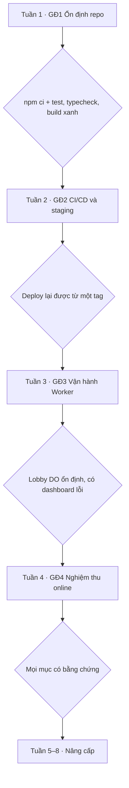

# OTTv2 — Kế hoạch triển khai và nâng cấp

Ngày 21/10/2026 · Repo: [MinhQuang1201/OTTv2](https://github.com/MinhQuang1201/OTTv2) · Commit đánh giá: `04512d3` (30/09/2026)

## Tóm tắt

OTTv2 đã chạy được cả local, AI và online trên production (Vercel + Cloudflare Worker), nhưng repo hiện tại không tái tạo được đúng bản đang chạy. Việc đầu tiên là đưa repo về trạng thái "cài được, test xanh, deploy lại được từ một commit", sau đó mới nâng cấp.

Kết luận chính sau khi đọc toàn bộ mã nguồn và chạy thử trên commit `04512d3` (30/09/2026):

- **Lõi game chắc chắn.** Luật thuần trong `rules.js` và trọng tài trong `room.js` tách bạch, có test tốt. 314/314 test web pass, typecheck và build web pass.
- **Cài đặt từ đầu bị lỗi.** `npm ci` thất bại vì xung đột peer dependency `@cloudflare/workers-types` (wrangler 4.141 cần v5, y-partyserver 2.2 cần v4). Chỉ chạy được với `--legacy-peer-deps`.
- **Test gốc không xanh.** 2 test unit fail trên HEAD: một do commit sửa README gần nhất, một do lỗi chặn đường dẫn chỉ đúng trên Windows trong `server.js`.
- **Production lệch với repo.** `DEPLOYMENT.md` ghi bản Vercel được build từ worktree có thay đổi chưa commit, trong khi README vẫn ghi online BLOCKED.
- **Lobby sẽ chậm dần.** Allocation đã kết thúc không bao giờ bị xoá, và mọi request đều liệt kê toàn bộ allocation trong một Durable Object duy nhất.

Thứ tự đề xuất: (1) ổn định repo và CI, (2) chuẩn hoá quy trình deploy, (3) sửa các lỗi vận hành của Worker, (4) nâng cấp AI và trải nghiệm.

## Hiện trạng

OTTv2 là game cờ 9×9 dựa trên oẳn tù tì: mỗi bên 10 quân (3 Đấm, 4 Lá, 3 Kéo), đi 1 ô theo 8 hướng, thắng bằng ô mục tiêu (a1/i9), ăn hết quân, đối phương hết nước, hết giờ hoặc bỏ cuộc. Có 4 chế độ: cùng máy, đấu AI, online theo phòng và xem trực tiếp (spectator).

### Thành phần

| Thành phần | Công nghệ | Vai trò | Quy mô |
| --- | --- | --- | --- |
| `packages/game-core` | JS thuần (UMD) | Luật, trọng tài, đồng hồ, AI | ~800 dòng |
| `packages/protocol` | TypeScript | Schema lệnh `ott:*` và catalog trận công khai | 228 dòng |
| `apps/web` | React 18 + Vite 5 + TS | Lobby, bàn cờ, kết quả, spectator, các session | ~7.300 dòng, 27 file test |
| `apps/worker` | Cloudflare Worker + Durable Objects (partyserver, y-partyserver) | Lobby cấp phòng và ticket HMAC, Game DO là trọng tài, Stream DO đẩy catalog | ~3.400 dòng |
| `vendor/playhtml-minimal` | Fork tối giản PlayHTML | Một kết nối WebSocket duy nhất từ trình duyệt | runtime build bằng esbuild |
| `server.js` | Node HTTP | Phục vụ file tĩnh khi chạy local | 128 dòng |
| `partykit/`, `tests/legacy/` | PartyKit 0.0.115 | Kiến trúc cũ, không còn deploy | legacy |

Production theo `DEPLOYMENT.md`: frontend tĩnh trên Vercel (`ottv2-two.vercel.app`), Worker tại `ottv2-minimal.haixcxt.workers.dev`, spectator đang bật. Deploy làm thủ công bằng `vercel` và `wrangler` CLI, không có CI.

### Kết quả chạy thử (Node 22.22, npm 10.9)

| Bước | Kết quả | Ghi chú |
| --- | --- | --- |
| `npm ci` | Fail | ERESOLVE peer `@cloudflare/workers-types`; chạy được với `--legacy-peer-deps` |
| `npm test` (unit, bỏ 4 file cần Worker thật) | 218/220 pass | 2 fail, xem mục Vấn đề |
| `npm test` đầy đủ | Treo | `worker-test-harness-runtime` chờ `wrangler dev --local` quá 10 phút |
| `npm run test:web` | 314/314 pass | 27 file |
| `npm run typecheck:web` | Pass | |
| `npm run build:web` | Pass | JS 410,5 kB (gzip 125 kB) |
| `tsc` cho `apps/worker` | Fail | `tsconfig` trỏ tới `node_modules/playhtml/node_modules/...` không tồn tại |
| `npm audit` | 12 lỗi | 2 critical, 7 high, 3 moderate; chủ yếu ở dev tooling |

## Vấn đề phát hiện

Có 15 vấn đề, 4 mức Cao. Phần lớn nằm ở khâu cài đặt, deploy và vận hành Worker, không phải ở luật chơi. Mỗi dòng đều đã được đối chiếu với mã nguồn hoặc kết quả chạy thử.

| # | Mức | Vị trí | Vấn đề | Cách sửa |
| --- | --- | --- | --- | --- |
| 1 | Cao | `package.json` | `npm ci` fail vì wrangler 4.141 đòi `@cloudflare/workers-types` ^5, y-partyserver 2.2 đòi ^4. Máy mới hoặc CI không cài được. | Thêm `overrides` cho `@cloudflare/workers-types` hoặc nâng y-partyserver; tạm thời dùng `.npmrc` với `legacy-peer-deps=true`. |
| 2 | Cao | Quy trình deploy | Bản Vercel đang chạy được build từ worktree chưa commit (`DEPLOYMENT.md`). Không ai tái tạo được production từ git. | Commit toàn bộ, gắn tag, chỉ deploy từ CI theo tag. |
| 3 | Cao | `ott-lobby-server.ts` | Allocation đã `terminal` không bao giờ bị xoá (chỉ xoá khi rollback). Mọi request, kể cả `list`, đều `storage.list` toàn bộ `allocation:*`. | Alarm dọn allocation terminal sau 24 giờ; tách index phòng đang chờ. |
| 4 | Cao | `ott-worker.ts` | Mọi control request đi vào một Lobby DO duy nhất (`idFromName("lobby")`). Đây là nút cổ chai khi có nhiều người chơi. | Chấp nhận ở quy mô hiện tại; đo tải trước, shard theo vùng nếu cần. |
| 5 | Trung bình | `tests/no-legacy-online-transport.test.js` | Commit "Update README.md" xoá các câu mà test bắt buộc phải có, nên test fail trên HEAD. | Khôi phục mục deploy trong README hoặc chuyển kiểm tra sang `DEPLOYMENT.md`. |
| 6 | Trung bình | `npm test` | `worker-test-harness-runtime` gọi `wrangler dev --local` không có timeout; chạy quá 10 phút rồi treo. | Tách `test:unit` và `test:integration`, đặt timeout cho mỗi test. |
| 7 | Trung bình | `apps/worker/tsconfig.json` | Trỏ tới `node_modules/playhtml/node_modules/...` không tồn tại. Worker không được typecheck. | Trỏ tới `@cloudflare/workers-types` gốc, thêm script `typecheck:worker`. |
| 8 | Trung bình | `ott-lobby-server.ts` | Rate limit 40 ms mỗi IP mỗi action (25 request/giây), và ghi storage DO ở mọi request. | Token bucket trong bộ nhớ, hoặc binding Rate Limiting của Cloudflare. |
| 9 | Trung bình | Thư mục gốc | README, `PRODUCT.md`, `CLAUDE.md`, `IMPLEMENTATION_STATUS.md` vẫn ghi online BLOCKED theo kiến trúc PartyKit; ~10 file handoff nằm ngay ở gốc. | Một nguồn trạng thái duy nhất; chuyển handoff vào `docs/history/`. |
| 10 | Trung bình | `npm audit` | 12 lỗi (2 critical, 7 high), chủ yếu từ vitest 2, esbuild/vite 5, sharp, busboy. | Nâng vitest, vite và wrangler theo từng bước, chạy lại test sau mỗi bước. |
| 11 | Thấp | `server.js` | `PRIVATE_RELATIVE_PREFIXES` dùng `\\` nên chỉ đúng trên Windows. Trên Linux/macOS, symlink trong `dist` trỏ vào `apps/worker` vẫn trả về file (test 154 fail: 200 thay vì 403). | Chuẩn hoá separator về `/` trước khi so sánh. |
| 12 | Thấp | `room.js` | `disconnectPlayer` hẹn giờ bằng `config.TIME_CONTROL.reconnectGraceMs` thay vì `this.reconnectGraceMs`, lệch với deadline đã lưu khi cấu hình grace khác 60 giây. | Dùng `this.reconnectGraceMs`. |
| 13 | Thấp | `room.js` | Hai ghế cùng hết grace đúng một thời điểm thì không ai thắng, ván treo. | Quy định luật hòa hoặc huỷ ván, ghi vào `Rule.md`. |
| 14 | Thấp | Worker | So sánh `x-ott-internal-secret` bằng `!==`; `compatibility_date` còn là 2024-09-23. | So sánh thời gian hằng; nâng compatibility date sau khi test. |
| 15 | Thấp | `partykit/`, `tests/legacy/`, deps | Code và dependency PartyKit cũ vẫn còn, làm nặng cài đặt và gây nhầm. | Xoá sau khi xác nhận không còn import. |

## Kế hoạch triển khai

Triển khai chia 4 giai đoạn; mỗi giai đoạn chỉ xong khi đạt tiêu chí ghi bên dưới. Giai đoạn 1 và 2 là bắt buộc trước mọi nâng cấp.

### Giai đoạn 1 — Ổn định repo

- [ ] Commit toàn bộ thay đổi đang nằm trên máy local (nhánh `hotfix/rule-game`), so với bản Vercel đang chạy để chắc chắn khớp. *(21/10: máy này không có nhánh `hotfix/rule-game`, worktree `developer` sạch; chưa đối chiếu được với bản Vercel — cần người giữ worktree deploy xác nhận.)*
- [x] Sửa xung đột peer: thêm `"overrides": { "@cloudflare/workers-types": "<bản wrangler cần>" }` vào `package.json`, sinh lại `package-lock.json`, xác nhận `npm ci` chạy không cần cờ. *(Dùng `@cloudflare/workers-types@5.20260925.1` làm devDependency + `overrides` trỏ về bản này; y-partyserver 2.2.0 đã là bản mới nhất nên không nâng được.)*
- [x] Sửa `apps/worker/tsconfig.json` và thêm `typecheck:worker`.
- [x] Tách script: `test:unit` (nhanh, không cần Worker), `test:integration` (wrangler dev, có timeout), `test:e2e` (Playwright hai profile). *(Runner `scripts/run-node-tests.js`; e2e cần `.dev.vars` có `OTT_INTERNAL_SECRET`.)*
- [x] Sửa 2 test fail: khôi phục mục deploy trong README; chuẩn hoá separator trong `server.js`. *(Hai lỗi này đã được sửa ở các commit sau `04512d3`. Trên HEAD `c89e9ff` sửa thêm: test C++ phụ thuộc g++, `server.test.js` báo rõ khi chưa build, và cleanup EBUSY của harness integration trên Windows.)*
- [x] Thêm `.nvmrc` (Node 22) và `engines` tương ứng.

**Tiêu chí xong:** trên máy sạch, `npm ci && npm run test:unit && npm run test:web && npm run typecheck:web && npm run typecheck:worker && npm run build:web` đều xanh. *(Thứ tự đúng: `build:web` trước `test:unit` vì `server.test.js` kiểm tra bản build thật. Đã đạt 21/10/2026 trên Windows, Node 22.14: unit 992/992, web 52 file, cả hai typecheck và build pass; `test:integration` 6 pass, 7 skip do thiếu `.dev.vars`.)*

### Giai đoạn 2 — CI/CD và deploy tái tạo được

1. Tạo GitHub Actions `ci.yml`: chạy mọi bước của giai đoạn 1 trên mỗi pull request; `test:integration` chạy với secret test sinh ngẫu nhiên trong job.
2. Bảo vệ nhánh `main`: bắt buộc CI xanh trước khi merge.
3. Tạo môi trường staging: Worker `ottv2-staging` (env riêng trong `wrangler.jsonc`, DO riêng) và Vercel Preview trỏ tới Worker staging.
4. Tạo `deploy.yml` chạy khi push tag `v*`: `wrangler deploy` dùng `CLOUDFLARE_API_TOKEN`, sau đó build frontend với `VITE_OTT_PLAYHTML_*` lấy từ GitHub Environment và deploy lên Vercel.
5. Ghi lại Worker version ID và URL Vercel vào GitHub Release của tag đó để rollback.
6. Smoke test tự động sau deploy: `POST /control/list` với Origin production phải trả 200 và có trường `rooms`.

**Tiêu chí xong:** production được deploy lại từ một tag, không có thao tác CLI trên máy cá nhân; rollback bằng cách deploy lại tag trước.

*Đạt 21/10/2026. Hạ tầng chuyển sang tài khoản Cloudflare và Vercel mới (Worker `*.opticsquang.workers.dev`, frontend `ottv2-psi.vercel.app`); production cũ trên `haixcxt` / `lap-trinh-mang` không còn là nguồn sự thật.*

- [x] Bước 1: `.github/workflows/ci.yml` — job `verify` và job `integration` (secret ngẫu nhiên) chạy xanh trên GitHub cho mọi pull request. Lần chạy đầu fail trên Linux và được sửa (dọn cây tiến trình wrangler/ProcessBot, JDK 21, test flaky).
- [x] Bước 2: `main` được bảo vệ — bắt buộc pull request và hai check CI xanh.
- [x] Bước 3: Worker `ottv2-staging` (Durable Objects riêng) và frontend `ottv2-staging.vercel.app`; deploy staging chạy xanh toàn bộ (run 39608459646).
- [x] Bước 4: `.github/workflows/deploy.yml` — `main` → staging, tag `v*` → production (cần người duyệt, chỉ nhận tag `v*`), chạy tay để rollback. Alias staging gọi thẳng API Vercel kèm `teamId` vì `vercel alias set` lỗi `User not found` với token theo team.
- [x] Bước 5: Release `v1.1.0` ghi Worker version ID `73a141f4-08f3-444d-9172-475873eedb43` và URL Vercel của lần deploy.
- [x] Bước 6: `scripts/smoke-deploy.js` chạy trong workflow; kiểm `POST /control/list` trả 200, CORS đúng origin, có `rooms`, bundle trỏ đúng Worker và không chứa tên secret.
- [x] **Cổng:** production deploy từ tag `v1.1.0` (run 39610056735), không dùng CLI trên máy cá nhân; smoke test pass.

*Còn lại và lưu ý:*

- Rollback bằng cách chạy tay Deploy trên tag `v*` trước chưa được thử. Tag `v1.0.0` (29/09) có trước CI nên không có workflow và không dùng được; rollback bằng tag chỉ có từ release thứ hai. Trong lúc đó dùng `wrangler rollback <version-id>`.
- Merge PR #13 không tự kích hoạt deploy staging (GitHub không tạo run, chưa rõ nguyên do); đã chạy tay bằng `workflow_dispatch`. Theo dõi nếu lặp lại.
- Chưa thực hiện nghiệm thu hai profile trên production; production vẫn ở trạng thái chờ giai đoạn 4.

### Giai đoạn 3 — Vận hành Worker an toàn

- [x] Alarm của Lobby xoá allocation `terminal` cũ hơn 24 giờ (kèm `terminal-outcome`); phòng đang chờ lưu ở key `waiting:<id>` nên `list` không quét `allocation:*`. Dữ liệu cũ được backfill một lần. *(Allocation của trận giải đấu không bị xoá vì coordinator còn đọc `terminal-outcome`.)*
- [x] Game DO tự `deleteAll` sau khi ván kết thúc 1 giờ (`OTT_TERMINAL_RETENTION_MS`); trong lúc đó ván vẫn đọc được.
- [~] Binding Rate Limiting `CREATE_RATE_LIMITER` (5 phòng/IP/phút, production và staging) áp dụng cho `create`. Giới hạn 40 ms mỗi action vẫn ghi storage vì test hiện tại ràng buộc key `rate:last:*`; thay hẳn cần sửa các test đó.
- [x] Bật Workers Logs (`observability`) và log JSON một dòng cho `authority_unavailable`, `transaction-failed`, `rate_limited` (`apps/worker/src/observability/log.ts`).
- [x] Hai ghế cùng hết grace: ghế còn ít thời gian hơn thua, bằng nhau thì ghế đang tới lượt thua (`Rule.md` mục 10.5, `room.js`). `reconnectGraceMs` đã đúng từ trước.
- [x] So sánh secret nội bộ bằng `internalSecretMatches` (thời gian hằng) ở cả bốn DO handler.

*Chưa kiểm chứng trên Cloudflare thật:* deploy staging, rồi tạo/kết thúc vài ván để xem key Lobby ổn định, và tạo dashboard/saved query trong Workers Logs lọc `event` theo ba lỗi trên. Hai việc này là điều kiện của tiêu chí bên dưới.

**Tiêu chí xong:** số key trong Lobby DO ổn định theo thời gian thay vì tăng mãi; có dashboard lỗi.

### Giai đoạn 4 — Nghiệm thu online

Chạy checklist trong `DEPLOYMENT.md` bằng hai profile trình duyệt thật trên production và ghi bằng chứng (ảnh chụp, log) vào `docs/evidence/`:

- [ ] Tạo phòng và vào phòng
- [ ] Nước hợp lệ lan sang máy kia; nước sai bị từ chối
- [ ] Reload và kết nối lại trong 60 giây
- [ ] Hết grace, hết giờ, chủ động rời bàn
- [ ] Xem trực tiếp (spectator) từ profile thứ ba
- [ ] Không thấy secret trong bundle, URL, storage
- [ ] Local và AI vẫn chạy khi Worker tắt

**Tiêu chí xong:** tất cả mục được tick kèm bằng chứng; khi đó mới đổi README từ "BLOCKED" sang "đã mở".

## Đề xuất nâng cấp

Nâng cấp đáng làm nhất là AI và luật hòa: AI hiện chỉ xét một nước nên dễ bị thắng, và ván local/AI không có đồng hồ nên có thể kéo dài vô hạn. Các mục xếp theo ưu tiên.

| Ưu tiên | Mảng | Đề xuất | Vì sao | Công sức |
| --- | --- | --- | --- | --- |
| 1 | AI | Thay `chooseMove` bằng minimax cắt tỉa alpha-beta độ sâu 3–4; hàm đánh giá gồm số quân theo loại, khoảng cách tới ô thắng, số nước đi được, quân đang bị đe doạ. | AI hiện không xét nước đáp trả, nên đi vào ô bị ăn hoặc để đối phương vào ô thắng. Mỗi bên tối đa 80 nước, nên độ sâu 4 vẫn khả thi. | 3–4 ngày |
| 2 | AI | 3 mức Dễ / Vừa / Khó (độ sâu 1 / 2 / 4); chạy AI trong Web Worker. | Người mới vẫn thắng được; tính toán sâu không làm đơ giao diện. | 1–2 ngày |
| 3 | Luật | Luật hòa: lặp thế cờ 3 lần hoặc 50 lượt liên tiếp không ăn quân. Thêm `reason: "draw"` vào `rules.js` và protocol. | Tránh ván vô tận ở local/AI; đồng thời giải quyết trường hợp hai ghế cùng hết grace. | 2 ngày |
| 4 | Online | Link mời ngắn (mã 6 ký tự, kèm QR) thay vì `ott-<uuid>`; nút "Đánh lại" sau ván. | `PRODUCT.md` hứa "vào bằng mã"; mã UUID không đọc cho nhau được. | 2–3 ngày |
| 5 | Trải nghiệm | Hoàn tác nước ở local/AI; xem lại ván từ lịch sử nước đi (đã có `MoveHistory` và event log). | Giúp học và phân tích, không đụng tới authority online. | 2 ngày |
| 6 | Trải nghiệm | Hướng dẫn chơi tương tác 5 bước cho người mới; sửa lỗi favicon đã ghi trong `TEST_REPORT.md`. | Luật "đòn thua là nước không hợp lệ" khác với oẳn tù tì thông thường, dễ gây bối rối. | 1–2 ngày |
| 7 | Hiệu năng | Tải lười (lazy load) runtime PlayHTML/Yjs chỉ khi vào online hoặc spectator. | Bundle hiện 410 kB (125 kB gzip); local/AI không cần phần online. | 1 ngày |
| 8 | Trải nghiệm | PWA: cài lên màn hình chính, chơi local/AI khi mất mạng. | Local/AI không cần server nên chạy offline được ngay. | 1 ngày |
| 9 | Hạ tầng | Một tên miền riêng cho cả frontend và Worker (ví dụ `ott.<domain>` và `api.ott.<domain>`); theo dõi lỗi frontend bằng Sentry. | URL ổn định, không phụ thuộc alias Vercel; thấy lỗi thật của người chơi. | 1 ngày |
| 10 | Chất lượng code | Chuyển `game-core` sang TypeScript, bỏ wrapper UMD và biến global `OTT_*`, dùng chung type với `protocol`. | Luật, client và Worker chia sẻ một định nghĩa type, giảm lỗi lệch dữ liệu. | 3 ngày |
| 11 | Mở rộng | Bảng xếp hạng Elo không cần tài khoản (Cloudflare D1), chat nhanh bằng câu có sẵn. | Tăng lý do quay lại; chat câu có sẵn tránh phải kiểm duyệt nội dung. | 1–2 tuần |

Nâng phiên bản dependency (Vite 6, Vitest 3, wrangler mới) nằm trong giai đoạn 1–2 vì nó gắn với lỗi `npm audit` và lỗi cài đặt.

## Lộ trình

Với một người làm bán thời gian, bốn giai đoạn triển khai mất khoảng 4 tuần; nâng cấp ưu tiên 1–7 mất thêm khoảng 4 tuần. Tuần tính từ ngày bắt đầu, chưa gắn ngày cụ thể.

| Thời gian | Giai đoạn | Nội dung chính | Cổng để sang bước sau |
| --- | --- | --- | --- |
| Tuần 1 | GĐ1 · Ổn định repo | Commit code local, sửa peer deps để `npm ci` chạy, sửa tsconfig của Worker; tách test:unit / integration / e2e, sửa 2 test fail, thêm `.nvmrc` | `npm ci` + toàn bộ test, typecheck, build xanh trên máy sạch |
| Tuần 2 | GĐ2 · CI/CD và staging | GitHub Actions cho mọi PR, bảo vệ nhánh main, Worker và Vercel staging; deploy production theo tag `v*`, smoke test tự động, ghi version để rollback | Production deploy lại được từ một tag, không dùng CLI trên máy cá nhân |
| Tuần 3 | GĐ3 · Vận hành Worker | Dọn allocation đã kết thúc, index phòng chờ, rate limit của Cloudflare; Workers Logs, xử lý hai ghế cùng hết grace, so sánh secret thời gian hằng | Số key trong Lobby DO ổn định theo thời gian, có dashboard lỗi |
| Tuần 4 | GĐ4 · Nghiệm thu online | Checklist hai profile trên production, spectator, kiểm tra lộ secret; lưu bằng chứng vào `docs/evidence/`, cập nhật README và tài liệu trạng thái | Mọi mục có bằng chứng, khi đó mới đổi trạng thái online sang "đã mở" |
| Tuần 5–8 | Nâng cấp | AI minimax 3 mức, luật hòa, link mời ngắn và đánh lại, hoàn tác và xem lại ván; hướng dẫn chơi, lazy load online, PWA, tên miền riêng, game-core sang TypeScript | — |

Không qua cổng thì không sang giai đoạn sau. Riêng nâng cấp AI và luật hòa chỉ đụng `game-core` và giao diện local, nên có thể làm song song từ tuần 2 nếu có người thứ hai.

## Rủi ro

Rủi ro lớn nhất là mất phần code chưa commit trên máy local, vì đó là phiên bản duy nhất khớp với production.

| Rủi ro | Khả năng | Ảnh hưởng | Giảm thiểu |
| --- | --- | --- | --- |
| Code chưa commit trên máy local bị mất hoặc ghi đè | Trung bình | Không tái tạo được production | Commit và push lên một nhánh ngay hôm nay, trước mọi thay đổi khác |
| Durable Object migration sai khi đổi cấu trúc storage Lobby | Trung bình | Mất phòng đang chơi; code rollback không khôi phục state DO | Thử trên staging trước; viết migration đọc được cả dữ liệu cũ lẫn mới |
| Nâng dependency làm hỏng PlayHTML fork hoặc partyserver | Cao | Online ngừng hoạt động | Nâng từng gói một, chạy `test:integration` và smoke hai profile sau mỗi lần |
| Lộ `OTT_INTERNAL_SECRET` khi đưa deploy lên CI | Thấp | Giả mạo ticket vào phòng | Secret chỉ nằm trên Cloudflare; CI chỉ giữ `CLOUDFLARE_API_TOKEN` giới hạn quyền |
| Vượt free tier Durable Objects khi bị spam tạo phòng | Thấp | Phát sinh chi phí hoặc bị chặn | Rate limit theo IP, giới hạn số phòng đang chờ, dọn allocation cũ |
| AI mạnh hơn làm chậm thiết bị yếu | Trung bình | Giao diện giật | Chạy trong Web Worker, giới hạn thời gian mỗi nước (ví dụ 500 ms) bằng iterative deepening |

**Đã giải quyết (21/10/2026):** thay vì xin quyền tài khoản cũ (`haixcxt`, `lap-trinh-mang`), nhóm tạo tài khoản Cloudflare và Vercel mới và cấp token cho CI. Token theo tài khoản của một thành viên; cần quyết định ai giữ lâu dài, vì token hết hạn hoặc bị xoá sẽ làm deploy dừng.
