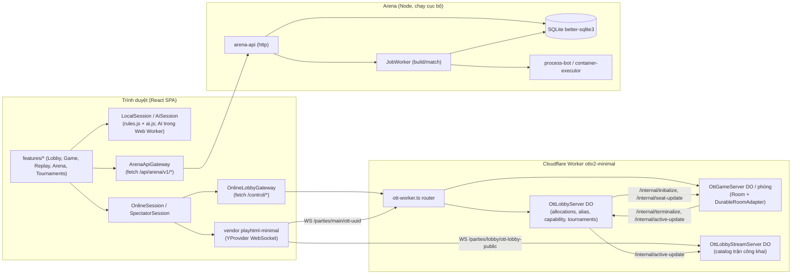
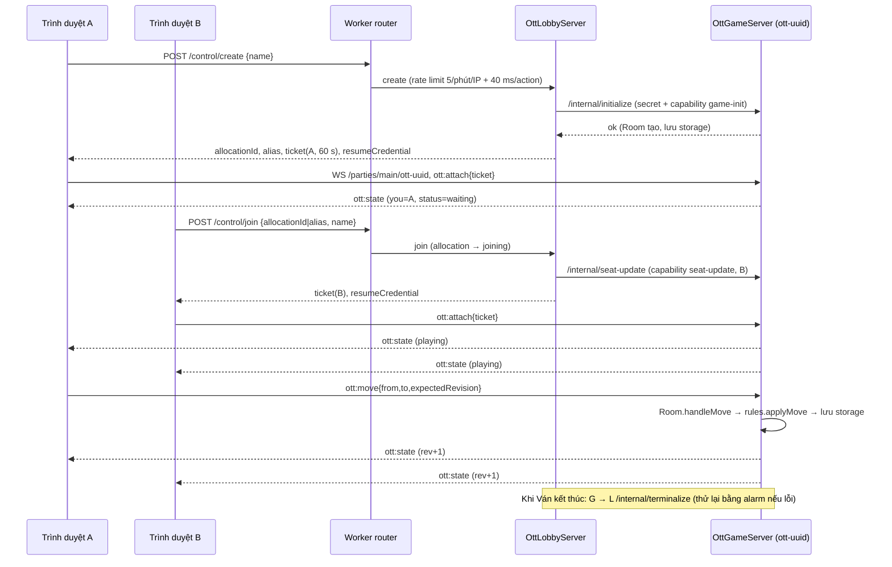

# OTTv2 — Project Overview (code-first audit)

> Ngày audit: **2026-10-23**. Commit được kiểm tra: `e3849c7` (nhánh `main`).
> Tài liệu này mô tả những gì **source code và kết quả chạy thực tế** cho thấy tại thời điểm audit.
> Tài liệu cũ (README, HANDOFF, CONTEXT, các báo cáo) chỉ được dùng để hiểu ngữ cảnh; chỗ nào mâu thuẫn với code đều được ghi rõ ở mục 9.4.
>
> **Cập nhật cùng ngày:** một số vấn đề đã được sửa sau audit, xem mục 12. Các mục 1–11 giữ nguyên trạng thái lúc audit.
>
> Quy ước bằng chứng:
> - **[RUN]**: đã thực thi trong audit này (lệnh/script và kết quả ghi ở mục 11).
> - **[CODE]**: suy ra từ việc đọc code, chưa thực thi riêng.
> - **[UNIT]**: có test tự động pass, nhưng chạy với fake/mock (không phải runtime thật).

---

## 1. Project Summary

**Bài toán.** OTTv2 là trò chơi cờ chiến thuật hai người trên bàn 9×9. Mỗi bên có 10 Quân thuộc ba Loại quân Đấm/Lá/Kéo (3/4/3). Mỗi Lượt đi 1 Ô theo 8 hướng. Ăn theo oẳn tù tì. Thắng bằng cách đưa Quân tới Ô thắng của mình (A: a1, B: i9), làm đối phương Tuyệt chủng, khiến đối phương không còn nước hợp lệ (`no_moves`), hoặc khi đối phương hết giờ, rời phòng hay mất kết nối quá thời gian ân hạn. Toàn bộ luật nằm trong một module thuần (`packages/game-core/src/rules.js`).

Repository thực tế chứa **hai hệ thống**:

1. **Trò chơi cho người chơi** (React SPA + Cloudflare Worker): chơi cùng máy, chơi với AI, chơi online hai ghế có trọng tài phía server, xem trực tiếp (spectator), xem lại replay, giải đấu người chơi.
2. **Đấu trường bot ("Arena")** (Node.js + SQLite, chạy cục bộ): tài khoản, upload mã nguồn bot (Node/Python/Java/C++), build, xếp lịch trận giữa các bot, chấm Elo, replay, giải đấu/competition. Đây là khoảng một nửa codebase nhưng **không được nhắc đến trong `CLAUDE.md`**.

**Đối tượng.** Người chơi (UI tiếng Việt). Người viết bot và quản trị viên (Arena). Có bằng chứng đây là đồ án môn "Lập trình mạng" (tên thư mục); điều này không ảnh hưởng tới kết luận kỹ thuật.

**Chức năng chính đã xác minh bằng chạy thực tế [RUN]:**
- Luật chơi, trọng tài `Room` (ghế, đồng hồ, ân hạn reconnect, rời phòng) và AI ba mức.
- Online qua Worker chạy `wrangler dev --local`: tạo phòng, vào phòng, attach bằng capability, đi nước, nhận snapshot riêng cho từng ghế (integration 12/12 test chạy đều pass). Luồng mời bằng mã ngắn, reload và resume, rời phòng trên hai profile Chromium: thân test chạy hết (xem mục 9, giới hạn trên Windows).
- Spectator trên Worker local (khi build có bật cờ spectator).
- Arena API: đăng nhập, tạo bot, build phiên bản Node và Python, trận ranked do worker nhúng chạy, finalize, Elo, replay, leaderboard.
- Static server `server.js` chặn path traversal và đường dẫn riêng tư.

**Giới hạn quan trọng:**
- Production (Cloudflare + Vercel) **không được kiểm tra** trong audit này. Smoke read-only bị chặn quyền thực thi, xem mục 11.
- Chưa có nghiệm thu thủ công giai đoạn 4 (theo README). Audit này không thay thế nghiệm thu đó.
- Danh sách trận đang diễn ra cho spectator **hỏng hoàn toàn khi có hơn ~21–23 trận đồng thời** (ISSUE-01).
- Trên Windows, khi đường dẫn repo có dấu cách (như máy audit), `npm run test:e2e` **không chạy được** (ISSUE-02/03).
- Phần Arena chạy bot không cô lập (trusted mode, mặc định) hoặc qua Docker. Chế độ Docker **BLOCKED** trong audit vì Docker daemon không chạy.

---

## 2. Technology Stack

| Lớp | Công nghệ khai báo | Thực sự được dùng trong code (đã kiểm tra) |
|---|---|---|
| Ngôn ngữ | JavaScript (CJS + ESM), TypeScript 5.7 | Game core: CJS/UMD JS. Worker và web: TS. Arena: ESM `.mjs`. SDK bot: JS/Python/Java/C++. |
| Runtime | Node ≥ 22 (`.nvmrc` = 22) | Node v22.14.0 trên máy audit. |
| Frontend | React 18.3, Vite 5.4, CSS Modules | `apps/web` (SPA, lazy-load Arena/Replay). AI chạy trong Web Worker (`apps/web/src/sessions/ai/ai.worker.ts`). |
| Realtime | `partyserver@0.5.10`, `y-partyserver@2.2.0`, `yjs@13.6.18` | Worker dùng `YServer` (y-partyserver) làm kênh WebSocket. Lệnh `ott:*` đi qua custom message. Tài liệu Yjs **không** được ghi (read-only, `onSave` rỗng). Client dùng `YProvider` trong bản vendor `vendor/playhtml-minimal/browser/runtime.js`. |
| Hạ tầng online | Cloudflare Workers + Durable Objects (SQLite-backed), Rate Limiting binding | `apps/worker/wrangler.jsonc`: 3 DO (`OttGameServer`, `OttLobbyServer`, `OttLobbyStreamServer`), `CREATE_RATE_LIMITER`. |
| Hosting frontend | Vercel (qua CI) | `.github/workflows/deploy.yml`. Không kiểm tra live. |
| Database Arena | `better-sqlite3@11.10.0` | 4 migration SQL, 22 bảng nghiệp vụ + `schema_migrations` (xác minh trên DB tạo mới, mục 6). |
| Thực thi bot | `child_process` (trusted-local), Docker (local-demo container) | Trusted: đã chạy Node/Python/Java. Docker: BLOCKED. |
| Test | `node:test`, Vitest 2.1 + jsdom + Testing Library, Playwright 1.60, Wrangler 4.141 | Tất cả đã chạy (mục 11). |
| Khác | `dotenv` (chỉ `server.js`), `esbuild` (qua Vite, dùng để build bundle PlayHTML) | — |

**Khai báo nhưng không phải phụ thuộc runtime của sản phẩm:** không có package `partykit` hay `playhtml` trong `package.json`. Thư mục `partykit/` là mã cũ, xem mục 3.3. `docs/playhtml/**` là tài liệu tham khảo upstream.

---

## 3. Architecture & Project Structure

### 3.1. Cấu trúc thư mục (phần có code)

```
packages/game-core/src/   Luật (rules.js), cấu hình (config.js), trọng tài Room (room.js), AI (ai.js), làm sạch tên (names.js)
packages/protocol/src/    Hợp đồng lệnh/phản hồi ott:*, validator catalog trận công khai, alias mã phòng
packages/game-client/src/ Bootstrap + adapter PlayHTML phía trình duyệt (OTT_PLAYHTML_CONNECTION_FACTORY)
vendor/playhtml-minimal/  Bundle runtime trình duyệt (YProvider) đã build sẵn và được commit
apps/web/                 React SPA: lobby, game, result, replay, spectator, tournaments, arena
apps/worker/              Cloudflare Worker: entry, Game DO, Lobby DO, Lobby Stream DO, auth capability, persistence
partykit/                 Mã PartyKit cũ. Chỉ room-storage.js còn được Worker import.
server.js                 Static server cho apps/web/dist (local/dev)
apps/arena-api/           HTTP API Arena (Node http), auth, routes
apps/arena-cli/           CLI: doctor, match
apps/arena-discovery/     Worker Cloudflare nhỏ lưu URL endpoint Arena (tunnel). CI không deploy.
packages/arena/           Domain Arena: ruleset, match controller, Elo, formats (swiss, round-robin), maps, human tournaments
packages/arena-node/      Hạ tầng Arena: SQLite repos, job queue, job worker, build/process/container executor, artifact store
sdk/arena/                SDK Python và bot mẫu (JS, Python, Java, C++)
bots/                     Bot tham chiếu (strategist, sentinel)
ops/arena/                Dockerfile + manifest image runner
scripts/                  worker-dev, chạy test, smoke deploy, arena demo
tests/                    ~80 file test node:test (+ fixtures). apps/web/src/**/*.test.* là test Vitest.
```

### 3.2. Entry points

| Thành phần | Entry | Khởi động |
|---|---|---|
| Web SPA | `apps/web/index.html` → `apps/web/src/main.tsx` | `npm run dev:web` (Vite), `npm run build:web` → `apps/web/dist` |
| Static server | `server.js` | `npm start` (cổng `PORT`, mặc định 3000). Chỉ phục vụ `apps/web/dist`. |
| Worker online | `apps/worker/src/entry/ott-worker.ts` | `npm run worker:dev` (`wrangler dev --local`), deploy qua CI |
| Worker test | `apps/worker/src/entry/ott-test-worker.ts` | Dùng bởi `wrangler.spectator-test.jsonc` và test |
| Arena API | `apps/arena-api/src/main.mjs` | `npm run arena:api` (127.0.0.1:3001, kèm job worker nhúng) |
| Arena worker ngoài | `packages/arena-node/src/worker/job-worker.mjs` | `npm run arena:worker` (khi `ARENA_EXTERNAL_WORKER=true`) |
| Arena CLI | `apps/arena-cli/src/main.mjs` | `npm run arena:cli`, `npm run arena:doctor` |
| Quản lý user Arena | `apps/arena-api/scripts/manage-user.mjs` | `npm run arena:user -- create ...` |
| Arena demo (Docker) | `scripts/arena-demo.js` | `npm run arena:demo` |

### 3.3. Vai trò module và ranh giới (đã đối chiếu code)

- **`rules.js`** [CODE+RUN]: hàm thuần, không I/O. `createInitialState` (`rules.js:85`), `getLegalMoves` (`:128`), `detectWinner` (`:157`), `applyMove` (`:180`), `elapseClock` (`:253`). Nước thua oẳn tù tì trả `ok:false` và không đổi trạng thái.
- **`room.js`** [CODE+RUN]: class `Room`. Giữ ghế A/B, `handleMove` (`:209`, có chống gửi trùng và kiểm `expectedRevision`), đồng hồ server-authoritative (`settleClock`), ân hạn reconnect (`disconnectPlayer` `:282`, `expireReconnect` `:365`), `leavePlayer` (`:319`), `resumePlayer` (`:339`).
- **Worker** [CODE+RUN]:
  - `ott-worker.ts`: router. Chỉ cho `/control/<action>` (tới DO `OTT_LOBBY` tên `"lobby"`), `/parties/main/ott-<uuid>` (Game DO) và `/parties/lobby/ott-lobby-public` (stream, chỉ khi `OTT_SPECTATOR_ENABLED=true`). Mọi path khác trả 404. CORS chỉ cho `OTT_BROWSER_ORIGIN`.
  - `OttLobbyServer` (`apps/worker/src/lobby/ott-lobby-server.ts`): cấp phát phòng (allocation), alias mã phòng ngắn, owner credential, ticket capability ký HMAC (TTL 60 s), join/resume/spectate, catalog trận công khai, GC phòng kết thúc (24 h), giải đấu người chơi (`TournamentCoordinator`).
  - `OttGameServer` (`apps/worker/src/game/ott-game-server.ts`): mỗi phòng một DO. Bọc `Room` bằng `DurableRoomAdapter` (`apps/worker/src/persistence/room-storage.ts`). Nhận `ott:attach|ott:spectate|ott:move|ott:leave`. Throttle 40 ms mỗi kết nối. Phát snapshot riêng theo người xem. Báo Lobby khi Ván kết thúc. Xóa toàn bộ storage sau thời gian giữ (mặc định 1 h).
  - `OttLobbyStreamServer`: phát catalog trận công khai tới client spectator qua WebSocket.
- **`partykit/`**: chỉ `room-storage.js` (serialize/hydrate `Room`) được Worker production import (`room-storage.ts:6`). `ott-room.js`, `ott-lobby.js`, `lobby.js`, `playhtml-*.js`, `protocol.js`, `connection.js` chỉ còn được test tham chiếu. Test "legacy" của chúng đang fail (ISSUE-09).
- **Web** [CODE+UNIT+RUN]: `apps/web/src/sessions/*` là ranh giới phiên (`local`, `ai`, `online`, `spectator`, `replay`, `demo`). Local/AI gọi `rules.js` qua `gameCoreBridge.ts`. Online chỉ gửi lệnh và vẽ snapshot server trả về (đúng ranh giới trong `CLAUDE.md`).

### 3.4. Sơ đồ kiến trúc



---

## 4. Core Features

Trạng thái là bằng chứng end-to-end mạnh nhất có được cho từng tính năng. Số liệu test chi tiết ở mục 11.

| # | Feature | Implementation Location | Actual Behavior | Test Status | Evidence | Limitations |
|---|---|---|---|---|---|---|
| F1 | Luật chơi | `packages/game-core/src/rules.js`, `config.js` | Thế trận ban đầu 10 Quân/bên (A ở e5–h8, B đối xứng 180°). Đi 1 Ô/8 hướng. Chặn Ô có Quân cùng phe hoặc cùng loại. Đòn thua bị từ chối và không đổi trạng thái. Thắng theo `goal`/`elimination`/`no_moves`/`timeout`. Đứng trên Ô thắng của đối phương không thắng. | **PASS** | [RUN] probe trực tiếp (mục 11.3). [UNIT] `rules.test.js`, `rules-fuzz.test.js` trong 1023 test unit pass. | — |
| F2 | Trọng tài `Room` (ghế, đồng hồ, ân hạn, rời phòng, resume) | `packages/game-core/src/room.js` | 10 phút/ghế, đồng hồ chỉ chạy ở ghế tới lượt và đang kết nối. `close` → ân hạn 60 s rồi `disconnect_timeout`. `leave` thua ngay. Từ chối người thứ ba, `stale_revision`, gửi trùng (trả `duplicate:true`). | **PASS** | [RUN] probe (mục 11.3). [UNIT] `room.test.js`. | Người tạo phòng rời phòng khi đang chờ: `winner="B"` dù ghế B trống (ISSUE-07). |
| F3 | AI 3 mức | `packages/game-core/src/ai.js` | Minimax alpha-beta có ngân sách nút: easy (sâu 1, có ngẫu nhiên), medium (sâu 2), hard (sâu 4, ≤100k nút). Trả nước hợp lệ. | **PASS** | [RUN] hard 129 ms/31 132 nút ở thế ban đầu. easy 1 ms, medium 7 ms. [UNIT] `ai.test.js`. | Đo trên một thế cờ, một máy. |
| F4 | Chơi cùng máy | `apps/web/src/sessions/local/LocalSession.ts` | Hai người thay phiên trên một trình duyệt. Đồng hồ cục bộ tick qua `elapseClock`. | **PASS** (jsdom) | [UNIT] Vitest 764/764. | Không chạy thủ công trong trình duyệt thật. |
| F5 | Chơi với AI | `apps/web/src/sessions/ai/*` | AI chạy trong Web Worker (`ai.worker.ts`), có fallback đồng bộ. Chọn mức AI ở lobby. | **PASS** (jsdom) | [UNIT] Vitest. | Web Worker thật trong trình duyệt chưa được chạy trong audit. |
| F6 | Kịch bản demo `?demo=` | `apps/web/src/sessions/demo/scenarios.ts` | 24 kịch bản (lobby/game/result/spectator), gồm các kịch bản ghi trong `CLAUDE.md`. | **PASS** (jsdom) | [UNIT] Vitest. | — |
| F7 | Replay (nhập JSON, ký hiệu nước, điều khiển, tách sang luyện tập) | `apps/web/src/features/replay/*`, `sessions/replay/*` | Nhập file replay, tua từng nước, tách ra Ván local/AI từ một frame. | **PASS** (jsdom) | [UNIT] Vitest. [RUN] Arena sinh replay hợp lệ (20 frame). | Chưa nạp replay Arena vào UI thật. |
| F8 | Static server | `server.js` | Chỉ GET/HEAD. Phục vụ `apps/web/dist`. Chặn traversal (`..`, `%2e%2e`, `\`), `server.js`, `package.json`, `.env`, `tests/`, `apps/worker/`. | **PASS** | [RUN] probe HTTP (mục 11.4). [UNIT] `server.test.js`. | Không có SPA fallback (app dùng query string nên không cần). |
| F9 | Online: tạo phòng → danh sách chờ → vào bằng mã → attach → đi nước | `OnlineSession.ts`, `OnlineLobbyGateway.ts`, `ott-lobby-server.ts` (create `:594`, join `:981`), `ott-game-server.ts` | Lobby DO cấp `allocationId`, alias, ticket attach (60 s), owner credential. Game DO xác thực ticket, gán ghế, chạy `Room`, phát snapshot theo ghế. | **PASS** (Worker local) | [RUN] `test:integration` 12 pass + 1 skip. [RUN] Playwright hai profile: thân test chạy hết dưới đường dẫn không dấu cách (mục 11.2). | Production không kiểm tra. Bộ e2e báo exit 1 trên Windows (ISSUE-02/03). Không phải nghiệm thu thủ công. |
| F10 | Online: reload + resume, rời phòng | `resumeStore.ts`, `ott-lobby-server.ts` resume `:694`, `room.js` | Credential được xoay vòng khi resume. Server không nhận ghế do client tự chọn. `leave` kết thúc Ván cho cả hai bên. | **PASS** (Worker local) | [RUN] integration test 3. [RUN] `browser-online-flow.test.js`: thân test chạy hết. | Như F9. |
| F11 | Mời bằng invite token cho phòng thường | `ott-lobby-server.ts` `create-invite` `:740`, `claim-invite` `:821`. `OnlineLobbyGateway.createSeatInvite` | Có ở server và gateway, nhưng **không có UI nào gọi** (mời thực tế là chia sẻ alias rồi `join`). Luồng `claim-invite` chỉ được UI giải đấu dùng. | **NOT TESTED** (runtime) | [CODE] grep UI. [UNIT] `online-revision-alias-invite.test.js`. | Rủi ro kẹt ghế B khi `seat-update` lỗi (ISSUE-08, chưa xác minh). |
| F12 | Hết giờ / hết ân hạn / phòng tạo mà không attach trên Worker | `room-storage.ts` `onAlarm` `:300`, `ott-game-server.ts` `publishCommitted` `:803` | Alarm DO settle đồng hồ, kết thúc Ván, gọi Lobby `/internal/terminalize`, thử lại khi lỗi. | **PASS** | [RUN] integration test 6 (hết hạn allocation chưa attach). [UNIT] `ott-game-room.test.js`, `worker-room-storage.test.js`. | Timeout đồng hồ và ân hạn trên runtime thật chỉ được test qua fake. |
| F13 | Spectator: danh sách trận công khai + xem read-only | `SpectatorSession.ts`, `PublicMatchList.tsx`, Lobby `spectate` `:678`, `OttLobbyStreamServer` | Ticket spectate, bàn cờ read-only, đếm người xem, catalog đẩy qua stream DO. | **PARTIAL** | [RUN] Playwright spectator: thân test chạy hết **khi build có `VITE_OTT_SPECTATOR_ENABLED=true`**. Không có cờ thì test fail (ISSUE-04). [RUN] validator: catalog bị từ chối khi > 21–23 trận (ISSUE-01). | Hỏng hoàn toàn khi tải đồng thời cao (ISSUE-01). Không nằm trong CI. |
| F14 | Giải đấu người chơi (swiss / vòng tròn) | `tournament-coordinator.ts`, `packages/arena/src/domain/human-tournaments/*`, `HumanTournamentDialog.tsx` | Tạo giải (secret cho ban tổ chức), đăng ký, bắt đầu, cấp phòng theo vòng, đồng bộ kết quả, sang vòng. Chỉ hỗ trợ map `classic`. | **NOT TESTED** (runtime) | [UNIT] `human-tournament-domain.test.js`, `online-hotfix-regression.test.js` (DO fake, bundle esbuild). | Chưa chạy trên Wrangler/runtime thật. |
| F15 | Deploy CI (main → staging, tag `v*` → production) và smoke | `.github/workflows/{ci,deploy}.yml`, `scripts/smoke-deploy.js` | CI: build, typecheck, unit, web, integration, e2e (Linux). Deploy: Worker và Vercel, kiểm tra secret, smoke. | **NOT TESTED** | [CODE] đọc workflow. Smoke read-only tới production bị chặn quyền trong phiên audit. | Không kiểm tra live. CI không chạy spectator e2e. |
| F16 | Arena: tài khoản và phiên | `apps/arena-api/src/http-server.mjs` (login `:283`), `auth/*`, `scripts/manage-user.mjs` | User do admin tạo bằng CLI (scrypt). Đăng nhập cấp bearer token. Giới hạn tần suất login sai theo username+IP. Đăng ký công khai tắt mặc định. | **PASS** | [RUN] smoke: đăng ký → 404 `REGISTRATION_DISABLED`, sai mật khẩu → 401, `/me` không token → 401. [UNIT] `arena-auth.test.js`. | — |
| F17 | Arena: bot, upload phiên bản, build (trusted-local) | `routes/bots.mjs`, `bot-version-service.mjs`, `build-service.mjs`, `profile-registry.mjs` | Cần Idempotency-Key. Trusted mode chỉ admin được nộp source (author nhận 403). Build bất đồng bộ qua job queue → `ready`. | **PASS** (Node, Python, Java) | [RUN] smoke: Node và Python `ready`. [RUN] `tests/runtime/arena-profiles.test.js` 12/12 với `node,python,java`. | C++ BLOCKED (máy không có g++). `/capabilities` vẫn quảng cáo `cpp` (ISSUE-05). |
| F18 | Arena: trận ranked/practice → job worker → finalize → Elo → replay → leaderboard | `routes/matches.mjs`, `job-worker.mjs`, `match-controller.mjs`, `finalizer.mjs`, `elo.mjs`, `routes/leaderboard.mjs` | Ranked chỉ admin. Trận chạy hai process bot qua NDJSON stdin/stdout. Kết quả có digest. Elo cập nhật. | **PASS** | [RUN] Node vs Python: `completed`, 19 nước, A thắng `goal`, replay 20 frame. Leaderboard có rating 1216/1184. | Bot lỗi import vẫn qua build và bị xử thua có tính Elo (ISSUE-06). |
| F19 | Arena: xem trận trực tiếp (live frames) | `live-frame-store.mjs`, `routes/matches.mjs` `/live`, `LiveMatchPanel.tsx` | Lưu frame khi đang chạy để UI poll. | **NOT TESTED** (runtime) | [UNIT] `arena-draft-live.test.js`, Vitest. | — |
| F20 | Arena: tournaments / competitions / rounds | `routes/{tournaments,competitions,competition-rounds}.mjs`, repos tương ứng, `packages/arena/src/domain/formats/*` | Round-robin, swiss, đăng ký/duyệt entry, sang phase, retry trận. | **NOT TESTED** (runtime) | [UNIT] `arena-tournament*.test.js`, `arena-competition*.test.js`, `arena-rounds-acceptance.test.js`. | — |
| F21 | Arena: chạy thử draft | `draft-service.mjs`, `routes/bots.mjs` `/draft/run` | Chạy source chưa lưu với bot đối thủ để xem trước. | **NOT TESTED** (runtime) | [UNIT] `arena-public-reads-draft.test.js`. | — |
| F22 | Arena: thực thi untrusted trong container Docker + bộ test cô lập | `container-executor.mjs`, `ops/arena/*`, `tests/isolation/arena-isolation.test.js`, `scripts/arena-demo.js` | Chạy bot Python/Node trong image pin `ottv2-arena-runner:local`. | **BLOCKED** | [RUN] `arena:doctor`: `container-executor: unavailable (docker_daemon_unavailable)`. | Cần Docker Desktop và image pin. |
| F23 | Arena CLI | `apps/arena-cli/src/main.mjs` | `doctor` (báo profile/khả năng), `match` (first-legal, in-process). | **PASS** (`doctor`) | [RUN] `npm run arena:doctor`. [UNIT] `arena-cli.test.js`. | `match` chỉ có unit test. |
| F24 | Arena discovery Worker | `apps/arena-discovery/src/index.mjs` | GET/PUT URL endpoint Arena (chỉ `*.trycloudflare.com`), CORS cho một origin Vercel cố định. | **PASS** (test riêng) | [RUN] `node --test apps/arena-discovery/discovery.test.mjs` 7/7. | Không thuộc npm script hay CI. `wrangler.jsonc` ghi cứng `account_id`. |
| F25 | Arena web UI | `apps/web/src/features/arena/*` | Màn Arena chỉ hiện khi có `VITE_OTT_ARENA_API_ENDPOINT` hoặc `VITE_OTT_ARENA_DISCOVERY_ENDPOINT`. | **NOT TESTED** (end-to-end) | [UNIT] Vitest với gateway mock. Test e2e `browser-arena-registration-demo` là opt-in và cần Docker. | `deploy.yml` không đặt biến Arena, nên bản deploy qua CI không có Arena [CODE]. |

---

## 5. Main User & System Flows

### 5.1. Chơi cùng máy / với AI (không mạng)

- **Trigger:** Lobby → "Cùng máy" hoặc "Đấu với AI" (`LobbyScreen.tsx:257`, `:264`).
- **Bước:** `App.tsx` tạo `LocalSession`/`AiSession` → `gameCoreBridge.ts` gọi `rules.applyMove`/`elapseClock` → snapshot → `GameScreen`. AI: `aiEngine.ts` gửi trạng thái sang `ai.worker.ts` → `chooseMove` → nước đi được áp lại qua `rules.applyMove`.
- **Kết quả:** Ván kết thúc với `ResultDialog`.
- **Test status:** PASS (jsdom + probe core). Không cần mạng.
- **Chưa xác minh:** chạy thủ công trong trình duyệt thật.

### 5.2. Online hai ghế (luồng chính)



- **Trigger:** "Chơi online" → "Tạo phòng" / "Vào phòng" với mã (`OnlineRoomPanel.tsx`).
- **Module/API:** `/control/{create,list,join,resume,active,spectate,resolve-alias,create-invite,claim-invite,tournament-*}` (POST JSON ≤ 4 KB). WebSocket y-partyserver với custom message `__ott` (≤ 8 KB, 40 ms/gói).
- **Phân quyền:** ticket HMAC theo `allocationId`/`roomId`/`purpose`/`seat`, sống 60 s, nonce dùng một lần [CODE `internal-auth.ts`, RUN integration test 4 "parallel reuse of one attach ticket mutates one seat and rejects its replay"]. Owner credential được băm và xoay vòng khi resume. Gọi giữa các DO cần header secret `OTT_INTERNAL_SECRET`.
- **Kết quả:** Snapshot riêng theo người xem (`projectRoomPayload`, `room-storage.ts:48`), không lộ `resumeToken` [UNIT].
- **Test status:** PASS trên Worker local. Production NOT TESTED.
- **Chưa xác minh:** hibernation/eviction DO thật, độ trễ mạng thật, nghiệm thu thủ công.

### 5.3. Reconnect / resume / rời phòng

- `close` socket → `Room.disconnectPlayer` dừng đồng hồ của ghế đó và đặt hạn 60 s. Alarm DO → `expireReconnect` → `disconnect_timeout`.
- Reload: client đọc `resumeStore` → `/control/resume` (xoay credential, ticket mới) → `ott:attach` → `Room.resumePlayer`.
- `ott:leave` → `Room.leavePlayer` → ghế kia thắng `leave` → terminalize.
- **Test status:** PASS (probe `Room` + integration test 3 + thân Playwright `browser-online-flow` chạy hết).

### 5.4. Spectator

- Lobby mở WS `/parties/lobby/ott-lobby-public` → nhận catalog `ott:active-matches` → bấm "Xem trận" → `/control/spectate` (ticket `spectate`) → WS Game DO `ott:spectate` → snapshot read-only có `spectatorCount`.
- Game DO gửi `/internal/active-update` cho Lobby DO sau mỗi commit. Lobby DO đẩy catalog sang Stream DO, thử lại tối đa 4 lần với backoff.
- **Test status:** PARTIAL. Luồng chạy được khi build có cờ spectator. Catalog hỏng khi > ~21 trận (ISSUE-01).

### 5.5. Arena: từ bot đến bảng xếp hạng

- **Trigger:** admin (trusted mode) hoặc author (chế độ container) gọi API, hoặc dùng UI Arena khi đã cấu hình endpoint.
- **Bước:** `POST /bots` → `POST /bots/:id/versions {source, profileId}` (lưu artifact theo digest, tạo job `build`) → JobWorker build → `ready` → `POST /matches {kind, participants}` → job `match` → `match-controller` chạy hai process bot (NDJSON, có đồng hồ) → `finalizer` ghi `match_results`, `rating_changes`, `bot_ratings` → `GET /matches/:id/replay`, `GET /leaderboard?ladderId=`.
- **Test status:** PASS cho trusted-local Node/Python [RUN]. Container BLOCKED.

### 5.6. Giải đấu người chơi

- **Trigger:** Lobby → "Giải đấu người chơi" (`HumanTournamentDialog`).
- **Bước:** `tournament-create` → `tournament-register` (secret người chơi) → `tournament-start` (khóa tạm 30 s, cấp phòng game cho từng cặp, sinh invite token) → `tournament-access` → người chơi `claim-invite` → chơi như 5.2 → `tournament-sync-match` / `tournament-advance`.
- **Test status:** NOT TESTED trên runtime thật (chỉ unit với DO fake).

---

## 6. Data Flow & Database

### 6.1. Online: Durable Object storage (key–value, backend SQLite)

| DO | Key chính (đọc trong code) | Ghi khi |
|---|---|---|
| `OttLobbyServer` (một instance, tên `"lobby"`) | `allocation:<id>` (status `initializing → waiting → joining → playing → terminal`), `waiting:<id>`, `alias:<ALIAS>`, `allocation-alias:<id>`, `owner-credential:<id>:<A\|B>`, `owner-ticket:<id>:<seat>`, `seat-invite:<token>`, `terminal-outcome:<id>`, `terminal-gc:<id>`, `rate:last:<action>:<client>`, `public-catalog-*`, `tournament:<id>`, `provisioning-fence:<id>` | create/join/resume/claim, terminalize, active-update, alarm (GC, retry) |
| `OttGameServer` (một instance mỗi phòng) | `allocationId`, `roomId`, `creatorName`, `creatorAttachDeadlineMs`, `room` (Room đã serialize), `live-attachment:<connId>`, `attach-nonce:*` / `spectate-nonce:*`, `allocationTerminalReason`, `terminalGcAt`, `terminalRetryReason`, `public-summary-sequence` | Mỗi lệnh `ott:*` hợp lệ (`DurableRoomAdapter.mutate`), alarm, đóng kết nối |
| `OttLobbyStreamServer` | catalog cache + `lobby-stream-resend*` | `/internal/active-update` |

**Nguồn sự thật:** trạng thái Ván chỉ nằm trong `room` của Game DO. Lobby chỉ giữ metadata cấp phát và bản tóm tắt công khai. Tài liệu Yjs không được lưu (`onSave` rỗng, `isReadOnly` = true).

**Điểm có thể gây mất nhất quán (đã thấy trong code):**
- Lobby và Game là hai DO, không có transaction chung. Code bù trừ bằng rollback (`withInitializationRollback`, `rollbackJoinReservation`) và retry bằng alarm (`scheduleTerminalRetry`) [CODE, có unit test].
- `claim-invite` cho phòng thường: nếu `/internal/seat-update` lỗi, `pendingSeatBInvite` vẫn nằm trên allocation và không có rollback (ISSUE-08) [CODE, chưa xác minh runtime].
- Catalog công khai được dựng lại toàn bộ mỗi lần và phải hợp lệ trọn vẹn. Một bản quá 8 KB làm toàn bộ catalog không khả dụng (ISSUE-01).

### 6.2. Arena: SQLite

- Migration: `packages/arena-node/src/persistence/migrations/001-arena.sql` … `004-arena-live-frames.sql`. Trên DB mới tạo trong audit, cả 4 migration đã áp dụng và có 22 bảng nghiệp vụ [RUN]: `users`, `auth_sessions`, `api_requests` (idempotency), `bots`, `bot_versions`, `artifacts`, `jobs`, `job_attempts`, `matches`, `match_participants`, `match_results`, `match_live_frames`, `bot_ratings`, `rating_changes`, `tournaments`, `tournament_entries`, `tournament_matches`, `tournament_standings`, `competitions`, `competition_entries`, `competition_rounds`, `competition_round_byes`.
- Quan hệ chính [CODE]: `bots` (owner → `users`) 1–n `bot_versions` (digest → artifact trên đĩa `ARENA_STORAGE_DIR`). `matches` 1–2 `match_participants` (khóa vào `bot_version_id` và digest) và 1–1 `match_results`. `rating_changes` → `bot_ratings` theo `ladderId`. `jobs` (build/match) n–1 phiên bản/trận.
- Ghi/đọc đã xác minh bằng smoke [RUN]: tạo user → session → bot → version → job build → `ready` → match → job match → result/Elo → replay → leaderboard.
- Dữ liệu ngoài DB: artifact source/build nằm trong `ARENA_STORAGE_DIR` (mặc định `var/arena/artifacts`, đã gitignore).

### 6.3. Web: lưu trữ phía client

- `localStorage`: tên người chơi (`playerNameStorage.ts`), thông tin resume ván online (`resumeStore.ts`), tùy chọn âm thanh và theme [CODE].

---

## 7. API & External Integrations

### 7.1. Worker online (`apps/worker`)

| Endpoint | Method | Mục đích | Auth |
|---|---|---|---|
| `/control/create` | POST | Tạo phòng, trả ticket A + credential | Rate limit 5/phút/IP (binding) + 40 ms/action |
| `/control/list` | POST | Danh sách phòng đang chờ | — |
| `/control/join` | POST | Vào ghế B bằng `allocationId`, `ott-<uuid>` hoặc alias | — (phòng giải đấu bị từ chối) |
| `/control/resume` | POST | Lấy ticket mới bằng resume credential | Credential băm, xoay vòng |
| `/control/active` | POST | Catalog trận công khai | Chỉ khi `OTT_SPECTATOR_ENABLED=true` |
| `/control/spectate` | POST | Ticket xem trận | Như trên |
| `/control/resolve-alias`, `create-invite`, `claim-invite` | POST | Alias và invite ghế B | `create-invite` cần owner credential ghế A |
| `/control/tournament-{create,register,start,get,access,sync-match,advance}` | POST | Giải đấu người chơi | Secret ban tổ chức / người chơi |
| `/parties/main/ott-<uuid>` | WS | Kênh Ván (`ott:attach/spectate/move/leave`) | Ticket capability |
| `/parties/lobby/ott-lobby-public` | WS | Stream catalog | Chỉ khi bật spectator |
| `/internal/*` (giữa các DO) | POST | initialize, seat-update, terminalize, active-update | Header `x-ott-internal-secret` |

CORS chỉ cho đúng `OTT_BROWSER_ORIGIN` (production: `https://ottv2-psi.vercel.app`, staging: `https://ottv2-staging.vercel.app`, theo `wrangler.jsonc`).

### 7.2. Arena API (`/api/arena/v1`, mặc định `127.0.0.1:3001`)

`GET /capabilities` · `POST /auth/register` (tắt mặc định) · `POST /auth/login` · `POST /auth/logout` · `GET /me` · `GET|POST /bots` · `GET|POST /bots/:id/versions` · `GET /bots/:id/ready-versions` · `POST /bots/:id/draft/run` · `GET|POST /matches` · `GET /matches/:id` · `GET /matches/:id/replay` · `GET /matches/:id/live` · `GET|POST /tournaments`, `POST /tournaments/:id/start` · `GET /competition-catalog` · `/competitions/...` (register, review, submission, advance, retry, next-round) · `GET /leaderboard?ladderId=`.

- Auth: bearer token từ `/auth/login`. Vai trò `admin`/`author`. Ranked và nộp source trong trusted mode chỉ dành cho admin [RUN]. GET công khai cho matches/tournaments.
- POST tạo tài nguyên bắt buộc có `Idempotency-Key` [RUN].
- CORS theo `ARENA_ALLOWED_ORIGINS`.

### 7.3. Dịch vụ ngoài

| Dịch vụ | Dùng cho | Bắt buộc khi | Trạng thái audit |
|---|---|---|---|
| Cloudflare Workers/DO | Online, spectator, giải đấu người chơi | Chơi online | Chỉ Worker local (Miniflare) |
| Vercel | Hosting SPA | Deploy | Không kiểm tra |
| GitHub Actions | CI/CD | Deploy | Chỉ đọc cấu hình |
| Docker | Arena container mode | `ARENA_LOCAL_DEMO_CONTAINERS=true` | BLOCKED |
| Cloudflare quick tunnel (`*.trycloudflare.com`) | Arena discovery | Demo Arena công khai | Không kiểm tra |

---

## 8. Run & Test Instructions

### 8.1. Cài đặt và chạy (suy ra từ `package.json` và config)

```bash
npm ci                     # Node >= 22
npm run build:web          # bắt buộc trước npm start và trước test:unit (server.test.js kiểm tra dist thật)
npm start                  # static server http://localhost:3000 (chỉ phục vụ apps/web/dist)
npm run dev:web            # Vite dev server
npm run worker:dev         # wrangler dev --local cho Worker online (cần .dev.vars, xem dưới)
npm run arena:user -- create --username <u> --role admin --password <p>   # tạo user Arena
npm run arena:api          # Arena API + job worker nhúng (127.0.0.1:3001)
```

Để UI kết nối Worker local hoặc Arena: đặt biến `VITE_*` lúc build hoặc dev (bên dưới). Không đặt thì online hiển thị unavailable, còn local/AI vẫn chạy.

### 8.2. Biến môi trường (chỉ tên)

- **Web (build-time):** `VITE_OTT_PLAYHTML_HOST`, `VITE_OTT_PLAYHTML_CONTROL_ENDPOINT`, `VITE_OTT_SPECTATOR_ENABLED`, `VITE_OTT_ARENA_API_ENDPOINT`, `VITE_OTT_ARENA_DISCOVERY_ENDPOINT`.
- **Static server / local runtime:** `PORT`, `OTT_WORKER_HOST`, `OTT_WORKER_PORT` (và `OTT_PLAYHTML_HOST`, `OTT_PLAYHTML_CONTROL_ENDPOINT` trong `.env.example`).
- **Worker:** secret `OTT_INTERNAL_SECRET` (local: file `.dev.vars`, đã gitignore). Vars `OTT_BROWSER_ORIGIN`, `OTT_SPECTATOR_ENABLED`. Chỉ dùng cho test: `OTT_TEST_CLOCK_MS`, `OTT_TEST_RECONNECT_GRACE_MS`, `OTT_TEST_CREATOR_ATTACH_TTL_MS`, `OTT_TERMINAL_RETENTION_MS`. Binding `CREATE_RATE_LIMITER`.
- **Arena:** `ARENA_API_PORT`, `ARENA_API_HOST`, `ARENA_DB_PATH`, `ARENA_STORAGE_DIR`, `ARENA_ALLOWED_ORIGINS`, `ARENA_MAX_BODY_BYTES`, `ARENA_MAX_SOURCE_BYTES`, `ARENA_TRUSTED_MODE`, `ARENA_PUBLIC_REGISTRATION`, `ARENA_LOCAL_DEMO_CONTAINERS`, `ARENA_EXTERNAL_WORKER`.
- **Test:** `OTT_BROWSER_RUNTIME_TEST`, `OTT_SPECTATOR_RUNTIME_TEST`, `OTT_RECONNECT_RUNTIME_TEST`, `OTT_ARENA_ENABLED_PROFILES`, `OTT_ARENA_DEMO_E2E`.
- **CI deploy:** secrets `CLOUDFLARE_API_TOKEN`, `CLOUDFLARE_ACCOUNT_ID`, `VERCEL_TOKEN`, `VERCEL_ORG_ID`, `VERCEL_PROJECT_ID`. Vars `WORKER_URL`, `FRONTEND_URL`.

### 8.3. Lệnh test đã xác minh trong audit

| Lệnh | Kết quả trên máy audit |
|---|---|
| `npm run build:web` | OK (cảnh báo chunk 533.78 kB > 500 kB) |
| `npm run typecheck:web`, `npm run typecheck:worker` | OK, không lỗi |
| `npm run test:unit` (= `npm test`) | 1023/1023 pass, 0 skip |
| `npm run test:web` | 60 file, 764/764 pass |
| `npm run test:integration` (cần `.dev.vars`) | 12 pass, 1 skip có chủ đích (placeholder nghiệm thu thủ công) |
| `npm run test:e2e` | **FAIL trên Windows khi đường dẫn có dấu cách** (ISSUE-02). Dưới đường dẫn không dấu cách: thân test chạy hết, nhưng suite vẫn exit 1 do hook dọn dẹp (ISSUE-03) |
| `npm run test:browser-worker:spectator` (logic tương đương) | FAIL khi build không có `VITE_OTT_SPECTATOR_ENABLED=true` (ISSUE-04). Có cờ: thân test chạy hết |
| `OTT_ARENA_ENABLED_PROFILES=node,python,java node --test tests/runtime/arena-profiles.test.js` | 12/12 pass |
| `npm run test:arena:isolation` | BLOCKED (cần Docker) |
| `npm run arena:doctor` | OK |

### 8.4. Điều kiện để chạy đầy đủ

- `.dev.vars` có `OTT_INTERNAL_SECRET` (bất kỳ chuỗi ngẫu nhiên nào cho local, như CI làm).
- Playwright Chromium (`npx playwright install chromium`).
- Trên Windows: đặt repo ở đường dẫn **không có dấu cách** (cho tới khi sửa ISSUE-02). Dù vậy suite vẫn có thể exit 1 do ISSUE-03.
- Arena container: Docker Desktop (linux/amd64) và image `ottv2-arena-runner:local` đúng digest trong `ops/arena/image-manifest.json`.
- Profile C++: `g++`/`clang++` có trong PATH.

---

## 9. Audit Results

### 9.1. Tổng hợp trạng thái (theo bảng F1–F25 ở mục 4)

| Trạng thái | Số lượng | Tính năng |
|---|---|---|
| PASS | 16 | F1–F10, F12, F16, F17, F18, F23, F24 |
| PARTIAL | 1 | F13 (spectator) |
| FAIL | 0 | — (không tính năng sản phẩm nào chạy sai trong phạm vi đã thực thi; các FAIL nằm ở công cụ test, xem 9.3) |
| BLOCKED | 1 | F22 (container Docker) |
| NOT TESTED | 7 | F11, F14, F15, F19, F20, F21, F25 |
| **Tổng** | **25** | |

Ghi chú: F4–F7 PASS ở mức jsdom/Vitest, không phải trình duyệt thật. F9–F10 PASS trên Worker local, không phải production.

### 9.2. Danh sách vấn đề

| ID | Mức độ | Chức năng | Mô tả | Vị trí | Bằng chứng | Tác động | Độ chắc chắn / phạm vi chưa xác minh |
|---|---|---|---|---|---|---|---|
| ISSUE-01 | **High** (khi có tải) | Spectator (F13) | Catalog trận công khai phải ≤ 8 KB **và** ≤ 100 trận. Vượt ngưỡng thì validator từ chối **toàn bộ** catalog thay vì cắt bớt. Ngưỡng 8 KB đạt ở khoảng **21–23 trận đồng thời**. `currentPublicCatalog()` khi đó trả `null`. | `packages/protocol/src/index.ts:1,6,180-205`. `apps/worker/src/lobby/ott-lobby-server.ts:346-367` (`currentPublicCatalog`), `:581-585` (`active` → 503 `catalog_unavailable`), `:498-501` (giao stream → restore/retry) | [RUN] Bundle validator thật, sinh N trận hợp lệ: tên 5 ký tự hợp lệ tối đa 23, N=24 → `invalid_payload`. Tên 20 ký tự hợp lệ tối đa 21, N=22 → `invalid_payload`. | Từ trận thứ ~22, mọi người không xem được danh sách trận. Thông báo stream thử lại rồi cạn lượt. Các Ván vẫn chơi bình thường. | Cao với validator. Hành vi end-to-end của Worker với > 21 Ván thật **chưa chạy**, chỉ suy từ code. Allocation của phòng giải đấu cũng được tính vào catalog [CODE]. |
| ISSUE-02 | Medium (công cụ) | `npm run test:e2e` | Trên Windows, fixture gọi `cmd.exe /d /s /c "<chuỗi đã quote>"` mà **không** có `windowsVerbatimArguments` (khác `scripts/worker-dev.js`). Đối số chứa dấu cách (`--env-file`, `--persist-to`) bị tách nên Wrangler không khởi động. | `tests/worker-runtime/fixture.js:60-67` | [RUN] Cả 2 test fail sau 30 s: `node.exe: "D:\Ky1nam4\Lập: not found`. Chạy lại từ ổ `subst` không dấu cách thì Wrangler khởi động. | Dev trên Windows (đường dẫn có dấu cách) không chạy được e2e cục bộ. | Nguyên nhân khả dĩ nhất (khác biệt code + tái hiện). CI Linux không bị ảnh hưởng [suy luận]. |
| ISSUE-03 | Low (công cụ) | `npm run test:e2e` | Hook dọn dẹp `fs.rmSync(persistTo)` gặp `EBUSY` vì workerd còn giữ cache Miniflare. Thân test pass nhưng suite báo `not ok` (`failureType: hookFailed`) và exit 1. | `tests/worker-runtime/fixture.js:166` | [RUN] 3 lần chạy dưới `W:\OTTv2` đều `EBUSY ... miniflare-CacheObject`. | Kết quả e2e trên Windows luôn đỏ, che mất lỗi thật. | Chỉ quan sát trên Windows. |
| ISSUE-04 | Medium (công cụ/CI) | Spectator e2e | Script `test:browser-worker:spectator` build web **không** đặt `VITE_OTT_SPECTATOR_ENABLED`. Fixture chỉ inject host. `applyWebRuntimeConfig` ghi đè `globalThis.OTT_SPECTATOR_ENABLED=false` khi load. Hệ quả: test spectator không thể pass từ shell sạch. CI cũng không chạy test này. | `package.json:14`. `apps/web/src/runtime-config.ts:110`. `tests/browser-worker-runtime.test.js:101` | [RUN] Không cờ: `TimeoutError` chờ nút "Xem trận…Alice…Bob". Build có cờ: thân test chạy hết. | Đường spectator không có kiểm tra browser tự động nào thực sự chạy (CI không có, script local hỏng). | Cao. |
| ISSUE-05 | Low | Arena `/capabilities` (F17) | Trusted mode trả `profiles: ["python","node","cpp","java"]` theo danh sách tĩnh, không theo kết quả probe. `arena:doctor` trên cùng máy báo `cpp: unavailable`. | `apps/arena-api/src/http-server.mjs:257-273` | [RUN] smoke `/capabilities` và `arena:doctor`. | UI/client có thể đề xuất profile không build được. | Cao. Chưa thử upload phiên bản C++ để xem lỗi build cụ thể. |
| ISSUE-06 | Low (thiết kế cần xác nhận) | Arena build và trận ranked (F17–F18) | Build chỉ kiểm tra/biên dịch, không chạy thử. Source lỗi khi chạy vẫn `ready`, vào trận ranked thì thua `forfeit/crash` **và vẫn bị tính Elo**. Bot mẫu `sdk/arena/examples/first_legal.py` import `ott_bot` từ thư mục SDK bên cạnh, nên **không chạy được khi upload như một file đơn**. | `sdk/arena/examples/first_legal.py:13-18`. `packages/arena-node/src/execution/build-service.mjs`. `finalizer.mjs` | [RUN] Upload `first_legal.py` → `ready` → trận ranked: `"Acting seat B faulted: Stdout closed..."`, Elo 1200→1184. Bot Python tự chứa thì thắng/thua bình thường (19 nước). | Người dùng làm theo SDK mẫu có thể mất Elo vì lỗi đóng gói. | Việc tính Elo khi crash có thể là chủ đích; cần chủ dự án xác nhận. |
| ISSUE-07 | Low | `Room.leavePlayer` (F2) | Người tạo phòng rời khi phòng đang chờ (chưa có ghế B): Room đặt `winner="B"`, `reason="leave"`, `status="done"` dù ghế B trống. | `packages/game-core/src/room.js:319-337` | [RUN] probe: `{"status":"done","winner":"B","reason":"leave","hasB":false}`. | Lobby nhận terminalize với `winner:"B"`. Màn kết quả có thể hiển thị Xanh thắng trong phòng không có Xanh. | Hành vi Room đã xác nhận. Ảnh hưởng UI **chưa xác minh**. |
| ISSUE-08 | Low (rủi ro) | `claim-invite` phòng thường (F11) | Khi `/internal/seat-update` thất bại, `pendingSeatBInvite` đã ghi vào allocation không được gỡ (khác nhánh `join` có `rollbackJoinReservation`). Alarm chỉ xóa bản ghi invite, không xóa cờ này, nên `join` trả `not_available` mãi. | `apps/worker/src/lobby/ott-lobby-server.ts:900-902`, `:942-945`, `:983` | [CODE] đọc luồng. | Phòng có thể kẹt ở trạng thái chờ. Hiện UI không gọi luồng này (F11), nên khả năng xảy ra thấp. | **Chưa xác minh runtime** (cần tiêm lỗi seat-update). |
| ISSUE-09 | Low (nợ kỹ thuật) | `partykit/` | Bộ test legacy fail 13/24 (`partykit-room.test.js`, `partykit-runtime.test.js`). Chúng kiểm tra `OttRoom`/`PartyKitOttRoom` đã không còn được dùng. `room-storage.js` (vẫn dùng ở production) có test serialize/hydrate trong suite unit đang pass. | `partykit/*.js`, `tests/legacy/*` | [RUN] `node --test tests/legacy/*.js`: 10 pass, 13 fail, 1 skip. | Mã chết gây nhầm lẫn. Không ảnh hưởng runtime. | Cao. |
| ISSUE-10 | Low (vệ sinh repo) | Test Python | Chạy test để lại `sdk/arena/python/__pycache__/` chưa được `.gitignore`. | `.gitignore` | [RUN] xuất hiện sau khi chạy test, đã được xóa thủ công trong audit. | Dễ commit nhầm. | Cao. |
| ISSUE-11 | Info | Build web | Chunk chính 533.78 kB (gzip 161 kB) vượt ngưỡng cảnh báo 500 kB. | `vite build` | [RUN] | Tải trang đầu chậm hơn. | — |

### 9.3. FAIL ở tầng công cụ (không phải tính năng sản phẩm)

- `npm run test:e2e` trên máy audit: FAIL (ISSUE-02, ISSUE-03).
- Spectator e2e từ shell sạch: FAIL (ISSUE-04).
- Test legacy `tests/legacy/*`: FAIL (ISSUE-09). Không nằm trong npm script hay CI.

### 9.4. Tài liệu mâu thuẫn với code

| Tài liệu nói | Code/runtime cho thấy |
|---|---|
| `CONTEXT.md`, `CLAUDE.md` (mục PlayHTML): rollout PlayHTML/PartyKit **BLOCKED**, "online UI phải unavailable", nhắc PartyKit `0.0.115`. | Online đã được hiện thực trên Cloudflare Workers + `partyserver@0.5.10`/`y-partyserver@2.2.0` (không phụ thuộc package `partykit`). UI online hoạt động khi có cấu hình endpoint. Integration và e2e local chạy được. `README.md` (22/10/2026) mô tả đã deploy production `v1.3.0`. Audit này **không** kết luận gì về trạng thái "Task 5" hay mức production-ready (theo `CLAUDE.md`, trạng thái đó thuộc `docs/playhtml-upstream-lock.md`). |
| `CLAUDE.md` mô tả ranh giới module nhưng không nhắc Arena. | Arena (API, worker, SQLite, CLI, SDK, discovery, UI) chiếm khoảng một nửa source. |
| `CLAUDE.md`: "Online dùng Worker/PlayHTML". | Đúng về kênh truyền: bundle `vendor/playhtml-minimal` chỉ là `YProvider` + shim tối thiểu. State Ván không đi qua dữ liệu PlayHTML/Yjs. |

### 9.5. Cần kiểm tra thêm

- Production/staging: chạy `scripts/smoke-deploy.js` (read-only) và một Ván thật hai thiết bị.
- Hibernation/eviction DO thật giữa Ván (đồng hồ, alarm, rebind kết nối).
- Giải đấu người chơi trên Worker thật (F14).
- Arena: competitions/tournaments/live/draft trên API thật. Chế độ container với Docker. Profile C++.

---

## 10. Known Limitations & Next Steps

### 10.1. Giới hạn đã xác nhận

- Catalog spectator vỡ ở khoảng 21–23 trận đồng thời (ISSUE-01).
- Bộ e2e không chạy được trên Windows với đường dẫn có dấu cách và luôn đỏ do cleanup (ISSUE-02/03). Spectator e2e không tự chạy được và không có trong CI (ISSUE-04).
- Arena trusted mode chạy source bot trực tiếp trên host (không sandbox). Code chủ động giới hạn: chỉ admin được nộp source, API bind loopback mặc định.
- Bản deploy qua CI không cấu hình Arena (thiếu `VITE_OTT_ARENA_*` trong `deploy.yml`) [CODE].
- Giải đấu người chơi chỉ hỗ trợ map `classic` (`tournament-coordinator.ts`).

### 10.2. Rủi ro cần kiểm tra thêm

- ISSUE-08 (kẹt `pendingSeatBInvite`) nếu sau này UI dùng invite cho phòng thường.
- Rate limit `create` dựa trên `cf-connecting-ip`. Request không có IP dùng chung bucket `"anonymous"` và bỏ qua binding (comment trong code nói đây là chủ đích cho local/internal).
- Mỗi lần commit nước đi, Game DO gọi Lobby DO (`active-update`). Một Lobby DO duy nhất phục vụ mọi phòng, nên có thể thành điểm nghẽn khi tải cao (chưa đo).

### 10.3. Ưu tiên đề xuất (đề xuất, không phải lỗi đã xác nhận)

1. Sửa ISSUE-01: phân trang hoặc cắt bớt catalog, hoặc nâng giới hạn riêng cho catalog. Thêm test với > 25 trận.
2. Sửa harness e2e cho Windows (ISSUE-02/03) và cho script spectator đặt cờ build (ISSUE-04). Cân nhắc thêm spectator e2e vào CI.
3. Làm rõ chính sách tính Elo khi crash và kiểm tra chạy thử khi build (ISSUE-06). Làm bot mẫu Python tự chứa.
4. `/capabilities` dùng kết quả probe (ISSUE-05).
5. Dọn `partykit/` (chuyển `room-storage.js` vào `packages/`, xóa phần còn lại và test legacy) (ISSUE-09). Thêm `__pycache__/` vào `.gitignore` (ISSUE-10).
6. Cập nhật `CONTEXT.md`/`CLAUDE.md` theo kiến trúc thật và bổ sung phần Arena (9.4).

---

## 11. Audit Scope & Confidence

### 11.1. Phạm vi source đã đọc

- Đọc đầy đủ: `packages/game-core/src/*`, `apps/worker/src/entry/ott-worker.ts`, `apps/worker/src/lobby/ott-lobby-server.ts`, `apps/worker/src/game/ott-game-server.ts`, `apps/worker/src/persistence/room-storage.ts`, `packages/protocol/src/index.ts` (phần validator), `server.js`, `apps/arena-api/src/main.mjs`, `http-server.mjs` (dispatch/auth), `config.mjs`, `scripts/run-node-tests.js`, `scripts/worker-dev.js`, `scripts/smoke-deploy.js`, `.github/workflows/*`, `apps/worker/wrangler*.jsonc`, `vendor/playhtml-minimal/browser/runtime-entry.js`, `apps/web/src/runtime-config.ts`.
- Đọc một phần hoặc lần theo luồng: `auth/internal-auth.ts`, `tournament-coordinator.ts`, `ott-lobby-stream-server.ts`, `apps/web/src/app/App.tsx`, `sessions/*` (bridge, local, ai, online runtime/gateway), `features/lobby/*`, arena routes (bots, matches), `profile-registry.mjs`, `tests/worker-runtime/fixture.js`, `apps/arena-discovery/src/index.mjs`.
- **Chưa đọc chi tiết**: phần lớn component UI Arena/Replay/Competition, `container-executor.mjs`, `draft-service.mjs`, `competition-*-repository.mjs`, domain `swiss`/`round-robin`/`maps`, `packages/game-client/src/*` (chỉ biết vai trò qua import). Kết luận về các phần này dựa vào test tự động đã pass.

### 11.2. Lệnh đã chạy (máy audit: Windows 11, Node 22.14.0, npm 10.9.2)

| Lệnh | Kết quả |
|---|---|
| `npm run build:web` | exit 0, 1.4 s |
| `npm run typecheck:web` / `typecheck:worker` | exit 0 / exit 0 |
| `npm run test:unit` | 1023 test, 145 suite, 1023 pass, 0 fail, 0 skip (≈36 s) |
| `npm run test:web` | 60 file, 764 test pass (≈23 s) |
| `npm run test:integration` (với `.dev.vars` tạm, secret ngẫu nhiên) | 13 test: 12 pass, 1 skip (≈44 s) |
| `npm run test:e2e` tại `D:\Ky1nam4\Lập trình mạng\OTTv2` | 2/2 fail: Wrangler không khởi động (ISSUE-02) |
| e2e qua `subst W:` (`node scripts/run-browser-worker-runtime.js`) | 2 test `hookFailed` EBUSY. Thân test chạy hết (≈15.6 s và 8.4 s) |
| spectator e2e qua `W:` không cờ / có `VITE_OTT_SPECTATOR_ENABLED=true` | fail ở bước "Xem trận" / thân test chạy hết, cleanup EBUSY |
| `OTT_ARENA_ENABLED_PROFILES=node,python,java node --test tests/runtime/arena-profiles.test.js` | 12/12 pass |
| `node --test apps/arena-discovery/discovery.test.mjs` | 7/7 pass |
| `node --test tests/legacy/*.test.js` | 24 test: 10 pass, 13 fail, 1 skip |
| `npm run arena:doctor` | exit 0. Docker: `docker_daemon_unavailable`. C++: `cpp_compiler_not_found` |
| Script smoke Arena (scratchpad, DB tạm, cổng 3101/3102) | Mục 11.5 |
| Script probe luật/Room/AI (scratchpad) | Mục 11.3 |
| Probe static server (cổng 3105) | Mục 11.4 |
| Bundle validator `packages/protocol` (esbuild ra scratchpad) | Mục 9.2 ISSUE-01 |

### 11.3. Probe game-core [RUN] (trích)

- Thế trận ban đầu: A `e8l f8d e7k f7l g7d f6k g6l h6d g5k h5l`, 10 Quân/bên, 36 nước hợp lệ mỗi bên, không nước nào vào Ô thắng của mình.
- `Chưa tới lượt`, `Chỉ được đi 1 ô theo 8 hướng`, `Không được đi vào ô có quân cùng loại`, đòn thua → `ok:false`, số Quân không đổi.
- `goal` (A tới a1), đứng trên i9 không thắng, `elimination`, `no_moves` (Quân B bị vây), `timeout` (10 phút).
- Tên `<b>Alice</b> <script>x</script>` → `Alice x`.
- `Room`: đồng hồ trừ 5 000 ms cho A sau 5 s. Gửi trùng → `duplicate:true`. `stale_revision`. Ghế tới lượt mất kết nối → đồng hồ dừng, hạn 60 000 ms → `disconnect_timeout`. Resume đúng token OK, sai token bị từ chối. Người thứ ba bị từ chối.

### 11.4. Probe static server [RUN]

`/`, `/index.html`, `/playhtml-game.html` → 200. `/server.js`, `/package.json`, `/.env`, `/..%2fserver.js`, `/%2e%2e/server.js`, `/..\server.js`, `/apps/worker/...`, `/tests/...`, URL encode lỗi → 403. File không tồn tại → 404. `POST /` → 405. Header `Cache-Control: no-store` (html/js), `X-Content-Type-Options: nosniff`.

### 11.5. Smoke Arena [RUN]

DB và artifact tạm trong thư mục scratchpad (không đụng `var/`). Admin và author tạo bằng `manage-user.mjs`. Kết quả: `/capabilities` (trusted-local), đăng ký → 404, login sai → 401, `/me` không token → 401, tạo bot thiếu Idempotency-Key → 400, author nộp source → 403 `SOURCE_SUBMISSION_DISABLED`, build Node/Python → `ready`, author tạo trận ranked → 403, trận admin → `completed`, replay 200, leaderboard (cần `ladderId`) có rating, route lạ → 404.

### 11.6. Không thể kiểm tra

- Production/staging (Cloudflare, Vercel): smoke read-only bị cơ chế phân quyền của phiên audit từ chối. Không có quyền hay credential deploy.
- Docker container mode và bộ isolation: Docker daemon không chạy. Audit không khởi động Docker Desktop.
- Profile C++: không có compiler.
- Nghiệm thu thủ công hai thiết bị, hibernation/eviction DO thật.

### 11.7. Tác động của audit lên repository

- **Không sửa source code, test, cấu hình hay dependency.** Chỉ tạo file này.
- Tạm thời trong lúc audit (đều đã hoàn tác): tạo `.dev.vars` với secret ngẫu nhiên cho integration/e2e rồi xóa. Ánh xạ ổ `subst W:` rồi gỡ. `npm run test:e2e` build lại `vendor/playhtml-minimal/browser/runtime.js` (nội dung giống hệt, chỉ khác kết thúc dòng), đã khôi phục bằng `git checkout`. Xóa thư mục tạm `.wrangler/browser-worker-*` và `sdk/arena/python/__pycache__/` do test sinh ra. `apps/web/dist` (gitignore) được build lại ở cấu hình mặc định.
- Trạng thái git sau audit giống lúc bắt đầu, cộng thêm file này: `PROJECT_OVERVIEW.md` cũ (đang tracked) đã bị xóa khỏi working tree **trước** audit, và `PROJECT_OVERVIEW_22_10.md` (untracked) có sẵn từ trước. Audit không đụng tới hai file đó.

### 11.8. Kết luận có độ tin cậy thấp hoặc thiếu bằng chứng

- Tác động end-to-end của ISSUE-01 trên Worker thật (suy từ code và validator).
- ISSUE-08 (chỉ đọc code).
- ISSUE-02 nguyên nhân gốc chính xác (đã tái hiện và có khác biệt code, nhưng chưa thử sửa vì audit không sửa code).
- Hành vi CI Linux (chỉ đọc workflow, không xem log CI).
- F4–F7, F25: chỉ có bằng chứng jsdom/mock, chưa chạy tay trong trình duyệt.

---

## 12. Cập nhật sau audit (2026-10-23)

Các sửa đổi dưới đây chưa được commit. Sau khi sửa, toàn bộ bộ kiểm tra đã chạy lại trên máy audit: `build:web`, `typecheck:web`, `typecheck:worker` OK. `test:unit` 1027/1027. `test:web` 764/764. `test:integration` 12 pass + 1 skip. `test:e2e` (logic `run-browser-worker-runtime.js`) 2/2 pass **ngay tại đường dẫn có dấu cách**. Spectator e2e 1/1 pass.

| ID | Trạng thái | Thay đổi | Test hồi quy |
|---|---|---|---|
| ISSUE-01 | Đã sửa | `fitPublicMatchCatalog()` trong `packages/protocol/src/index.ts` giữ các trận đầu tiên vừa giới hạn 8 KB / 100 trận. `currentPublicCatalog()` dùng hàm này, nên catalog bị cắt thay vì không khả dụng. Thứ tự giữ nguyên, các trận vượt ngưỡng tạm thời không hiện trong danh sách. | `tests/spectator-test-worker.test.js` (40 trận) |
| ISSUE-02 | Đã sửa | `tests/worker-runtime/fixture.js` dùng `spawnLocalCommand` của `scripts/worker-dev.js` (`windowsVerbatimArguments`, quote kiểu `""`). | e2e chạy tại đường dẫn có dấu cách |
| ISSUE-03 | Đã sửa | Xóa thư mục state Wrangler bất đồng bộ, thử lại tối đa ~15 s khi `EBUSY`/`EPERM`/`ENOTEMPTY`, sau đó chỉ cảnh báo. | e2e không còn `hookFailed` |
| ISSUE-04 | Đã sửa | `scripts/run-browser-worker-runtime.js --spectator` tự build web với `VITE_OTT_SPECTATOR_ENABLED=true`. `test:browser-worker:spectator` bỏ bước `build:web` không có cờ. CI **chưa** chạy spectator e2e (chưa thêm). | spectator e2e 1/1 |
| ISSUE-05 | Đã sửa | `/capabilities` chỉ liệt kê profile có probe thành công, cache 5 phút (probe dùng `spawnSync`). Ở chế độ container có Docker thì không probe host. | `tests/arena-api.test.js` |
| ISSUE-07 | Đã sửa | Người tạo rời phòng đang chờ: phòng đóng với `reason: "leave"`, `winner: null`, không có sự kiện thắng. `partykit/room-storage.js` chấp nhận trạng thái này khi hydrate (giống `disconnect_timeout`). | `tests/room.test.js` |
| ISSUE-08 | Đã sửa (đã hiệu chỉnh mô tả) | Giữ chỗ ghế B sau lỗi `seat-update` là **chủ đích** (có test `online-hotfix-regression`). Lỗi thật: khi alarm xóa invite `pending` (hết hạn hoặc 60 s sau khi claim), chỗ giữ và owner credential ghế B không được gỡ, nên phòng kẹt vĩnh viễn. Alarm giờ gọi `releaseAbandonedSeatReservation()` trước khi xóa invite. | `tests/online-revision-alias-invite.test.js` |
| ISSUE-10 | Đã sửa | `.gitignore` thêm `__pycache__/`. | — |
| ISSUE-06 | Chưa sửa | Cần chủ dự án quyết định: có tính Elo khi bot crash không, có chạy thử khi build không, có biến bot mẫu Python thành file tự chứa không. | — |
| ISSUE-09 | Chưa sửa | Dọn `partykit/` là refactor (một số module còn được unit test dùng). Cần quyết định trước. | — |
| ISSUE-11 | Chưa sửa | Chỉ là cảnh báo kích thước bundle. | — |
| 9.4 | Chưa sửa | `CLAUDE.md`/`CONTEXT.md` là chỉ dẫn của dự án và có phần trạng thái do `docs/playhtml-upstream-lock.md` sở hữu, nên cần chủ dự án tự cập nhật. | — |
